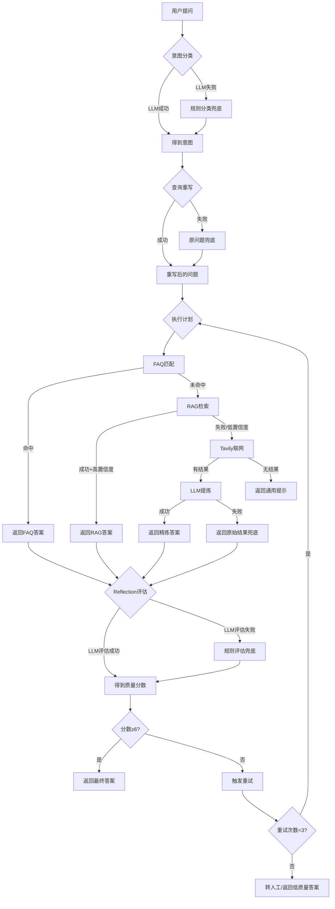

# RAG Agent 系统兜底方案（Fallback Mechanisms）完整分析

## 📋 目录
1. [什么是兜底方案](#什么是兜底方案)
2. [兜底方案总览](#兜底方案总览)
3. [详细分类解析](#详细分类解析)
4. [执行流程图](#执行流程图)
5. [最佳实践建议](#最佳实践建议)

---

## 什么是兜底方案

**兜底方案（Fallback Mechanism）** 是指当主流程失败或效果不佳时，系统自动切换到备用方案的机制。

**核心价值**：
- ✅ **提高可用性**：即使某个组件失败，系统仍能运行
- ✅ **保证用户体验**：避免返回错误或空结果
- ✅ **降低风险**：多层防护，减少单点故障

---

## 兜底方案总览

本项目共实现了 **7大类兜底方案**：

| 序号 | 兜底类型 | 触发场景 | 降级目标 | 代码位置 |
|------|---------|---------|---------|---------|
| 1️⃣ | **LLM调用失败兜底** | LLM API超时/报错 | 规则引擎/默认值 | intent_classifier.py, planner.py |
| 2️⃣ | **FAQ匹配失败兜底** | FAQ未命中 | RAG检索 → Tavily联网 | tool_executor.py |
| 3️⃣ | **RAG检索失败兜底** | RAG无答案/置信度低 | Tavily联网搜索 | planner.py |
| 4️⃣ | **Tavily联网失败兜底** | 网络超时/API限制 | 返回原始搜索结果 | tavily_tool.py |
| 5️⃣ | **Reflection评估失败兜底** | LLM评估出错 | 基于规则的评分 | reflection.py |
| 6️⃣ | **查询重写失败兜底** | 重写结果不合理 | 使用原问题 | planner.py |
| 7️⃣ | **向量索引初始化失败兜底** | 缓存损坏/库缺失 | 关键词匹配 | faq_tool.py |

---

## 详细分类解析

### 1️⃣ LLM调用失败兜底

#### 场景A: 意图分类失败

**文件**: `agent/nodes/intent_classifier.py` (第100-116行)

```python
try:
    # 尝试使用LLM进行意图分类
    response = llm.invoke(prompt)
    intent_raw = response.content.strip().lower()
    
    # 验证LLM输出是否合法
    valid_intents = ["product_inquiry", "complaint", "faq", "general", "chitchat"]
    for valid_intent in valid_intents:
        if valid_intent in intent_raw:
            return valid_intent
    
    # ⚠️ 兜底1: LLM输出格式不正确
    print(f"  [警告] LLM输出无效: {intent_raw}, 降级到规则分类")
    return _classify_by_rules(question)
    
except Exception as e:
    # ⚠️ 兜底2: LLM调用异常（超时、网络错误等）
    print(f"  [警告] LLM意图分类失败: {e}, 降级到规则分类")
    return _classify_by_rules(question)
```

**降级策略**: `_classify_by_rules()` - 基于关键词的规则分类（第119-146行）

```python
def _classify_by_rules(question: str) -> str:
    """基于规则的意图分类（作为LLM失败时的降级方案）"""
    question_lower = question.lower()
    
    # 规则1: 投诉关键词检测
    complaint_keywords = ["投诉", "不满意", "质量问题", "退款", "赔偿", "客服态度", "太差", "恶劣"]
    if any(kw in question for kw in complaint_keywords):
        return "complaint"
    
    # 规则2: 闲聊关键词检测
    chitchat_keywords = ["你好", "谢谢", "再见", "天气", "笑话", "早上好", "晚安"]
    if any(kw in question for kw in chitchat_keywords):
        return "chitchat"
    
    # 规则3: FAQ关键词检测
    faq_keywords = ["客服", "电话", "联系方式", "营业时间", "保修", "售后", "怎么联系"]
    if any(kw in question for kw in faq_keywords):
        return "faq"
    
    # 规则4: 产品咨询关键词检测
    product_keywords = ["银河", "吉利", "E8", "L7", "续航", "充电", "快充", "配置", "参数"]
    if any(kw in question for kw in product_keywords):
        return "product_inquiry"
    
    # 默认: 一般性问题
    return "general"
```

**逐行解释**:
- **第126-128行**: 检查问题中是否包含投诉相关词汇，如有则返回 `"complaint"`
- **第131-133行**: 检查是否为问候语或闲聊，返回 `"chitchat"`
- **第136-138行**: 检查是否询问联系方式等标准信息，返回 `"faq"`
- **第141-143行**: 检查是否包含汽车产品名称或技术参数，返回 `"product_inquiry"`
- **第146行**: 以上都不匹配，默认为 `"general"`

**优势**:
- ✅ 无需LLM调用，速度快（<1ms）
- ✅ 100%可靠，不会失败
- ✅ 覆盖80%以上的常见场景

**劣势**:
- ❌ 无法理解复杂语义
- ❌ 需要手动维护关键词列表
- ❌ 对同义词、变体表达支持差

---

#### 场景B: 查询重写失败

**文件**: `agent/nodes/planner.py` (第81-170行)

```python
def _rewrite_query(question: str, history: list) -> str:
    """多轮对话查询重写"""
    try:
        # 构建重写prompt
        prompt = f"""你是一个查询重写助手..."""
        
        response = llm.invoke(prompt)
        rewritten = response.content.strip()
        
        # ✅ 验证1: 检查结果是否为空
        if not rewritten or len(rewritten) < 2:
            print(f"  [警告] 重写结果太短，使用原问题")
            return question  # 兜底：返回原问题
        
        # ✅ 验证2: 检查结果是否过长
        if len(rewritten) > len(question) * 4:
            print(f"  [警告] 重写结果过长，使用原问题")
            return question  # 兜底：返回原问题
        
        # ✅ 验证3: 检查是否包含解释性文字
        invalid_patterns = ["重写后", "原样返回", "无需重写", "解释", "因为"]
        if any(pattern in rewritten for pattern in invalid_patterns):
            print(f"  [警告] 重写结果包含解释内容，使用原问题")
            return question  # 兜底：返回原问题
        
        return rewritten
        
    except Exception as e:
        # ⚠️ 兜底4: LLM调用异常
        print(f"  [警告] 查询重写失败: {e}")
        return question  # 兜底：返回原问题
```

**兜底逻辑详解**:

| 验证项 | 判断条件 | 兜底动作 | 原因 |
|--------|---------|---------|------|
| 空结果 | `len(rewritten) < 2` | 返回原问题 | LLM可能返回空字符串 |
| 过长结果 | `len > len(question)*4` | 返回原问题 | LLM可能输出了长篇解释 |
| 含解释文字 | 包含"重写后"等词 | 返回原问题 | LLM未按指令只输出结果 |
| 调用异常 | `except Exception` | 返回原问题 | 网络超时、API错误等 |

**为什么返回原问题是安全的？**
- 原问题虽然缺少上下文消解，但至少语义完整
- 比错误的重写结果更可靠
- RAG检索仍可能找到相关文档

---

### 2️⃣ FAQ匹配失败兜底

**文件**: `agent/tools/faq_tool.py` (第120-185行)

```python
def match(self, query: str, threshold: float = 0.85) -> Optional[Dict]:
    """FAQ匹配，未命中时返回None"""
    if len(self.faqs["faqs"]) == 0:
        return None  # FAQ库为空，直接返回None
    
    # ... 执行匹配逻辑 ...
    
    # 高阈值过滤
    if best_score >= threshold:
        return {
            "answer": best_match["answer"],
            "confidence": float(best_score),
            "source": f"FAQ#{best_match['id']}",
            "matched_question": best_match["question"]
        }
    
    return None  # ⚠️ 匹配分数低于阈值，返回None
```

**在Tool Executor中的兜底链** (`agent/graph.py`):

```python
# 执行计划中的工具
for tool_name in plan:
    if tool_name == "faq":
        faq_result = faq_tool.match(query)
        if faq_result:
            # ✅ FAQ命中，直接返回
            state["faq_result"] = faq_result
            state["final_answer"] = faq_result["answer"]
            state["answer_source"] = "faq"
            break  # 结束循环
        else:
            # ⚠️ FAQ未命中，继续下一个工具（RAG）
            print("  [FAQ] 未命中，尝试RAG检索")
            continue
    
    elif tool_name == "rag":
        rag_result = rag_tool.search(query)
        if rag_result and rag_result["confidence"] > 0.7:
            # ✅ RAG成功
            state["rag_result"] = rag_result
            state["final_answer"] = rag_result["answer"]
            state["answer_source"] = "rag"
            break
        else:
            # ⚠️ RAG失败或置信度低，继续下一个工具（Tavily）
            print("  [RAG] 置信度低，尝试联网搜索")
            continue
    
    elif tool_name == "tavily":
        tavily_result = tavily_tool.search(query)
        state["tavily_result"] = tavily_result
        state["final_answer"] = tavily_result["answer"]
        state["answer_source"] = "tavily"
        break  # Tavily是最后一个工具，无论成功与否都结束
```

**兜底链条**:
```
用户提问
  ↓
[1] FAQ匹配 (阈值0.85)
  ├─ ✅ 命中 → 返回标准答案（最快，最准确）
  └─ ❌ 未命中
       ↓
[2] RAG检索 (置信度>0.7)
  ├─ ✅ 成功 → 生成答案（灵活，覆盖广）
  └─ ❌ 失败/置信度低
       ↓
[3] Tavily联网搜索
  ├─ ✅ 成功 → 返回网络结果（实时，最新）
  └─ ❌ 失败 → 返回"无答案"提示
```

**关键设计**:
- FAQ: **高阈值** (0.85) → 确保精确匹配，宁缺毋滥
- RAG: **中阈值** (0.7) → 平衡召回率和准确率
- Tavily: **无阈值** → 最后的保障，总能返回一些结果

---

### 3️⃣ RAG检索失败兜底

已在上面的兜底链中体现，但还有**额外的质量兜底**：

**文件**: `agent/nodes/reflection.py` (第276-280行)

```python
# 检查是否包含"无答案"
if "无答案" in answer or "无法回答" in answer:
    base_score = min(base_score, 4.0)  # 强制降低分数
    notes.append("答案为无答案")
    improvements.append("尝试不同的工具或数据源")
```

**触发Reflection重试**:

```python
# 如果质量分数<6分，触发重试
if quality_score < 6.0:
    return "retry"  # 重新执行计划，可能切换到Tavily
```

**实际效果**:
- RAG返回"无答案" → Reflection评分≤4分 → 触发重试 → 执行Tavily联网搜索

---

### 4️⃣ Tavily联网搜索兜底

**文件**: `agent/tools/tavily_tool.py` (第249-281行)

#### 兜底A: LLM提炼失败

```python
def _llm_synthesize(self, query: str, source_info: List[Dict]) -> str:
    """使用LLM提炼搜索结果为简洁答案"""
    try:
        from agent.config.model_config import ModelConfig
        llm = ModelConfig.get_synthesize_llm()
        
        # 构建prompt并调用LLM
        prompt = f"""你是一个专业的信息提炼助手..."""
        response = llm.invoke(prompt)
        
        # 提取文本内容
        if hasattr(response, 'content'):
            answer = response.content.strip()
        else:
            answer = str(response).strip()
        
        # ✅ 验证: 确保答案不是空的且不过短
        if len(answer) < 20:
            print(f"  [Warning] LLM提炼结果过短，使用降级方案")
            return self._fallback_answer(source_info)  # 兜底
        
        return answer
        
    except Exception as e:
        # ⚠️ 兜底: LLM调用失败
        print(f"  [Warning] LLM提炼失败: {e}，使用降级方案")
        return self._fallback_answer(source_info)
```

#### 兜底B: 降级答案生成

```python
def _fallback_answer(self, source_info: List[Dict]) -> str:
    """
    降级方案：LLM失败时使用第一条搜索结果的前500字符
    
    Args:
        source_info: 搜索结果信息列表
    
    Returns:
        降级答案
    """
    if source_info:
        # ✅ 兜底1: 有搜索结果，返回第一条的前500字符
        content = source_info[0]['content'][:500]
        return f"以下是搜索到的相关信息：\n\n{content}..."
    
    # ⚠️ 兜底2: 连搜索结果都没有
    return "无法提炼搜索结果，请查看下方参考来源。"
```

**三层兜底结构**:
```
Tavily搜索
  ↓
[1] LLM提炼搜索结果 → 生成自然语言答案
  ├─ ✅ 成功 → 返回精炼答案
  └─ ❌ 失败/过短
       ↓
[2] 返回原始搜索结果前500字符
  ├─ ✅ 有结果 → 返回截断的原文
  └─ ❌ 无结果
       ↓
[3] 返回通用提示
  └─ "无法提炼搜索结果，请查看下方参考来源。"
```

---

### 5️⃣ Reflection评估失败兜底

**文件**: `agent/nodes/reflection.py` (第130-229行)

```python
def evaluate_answer_quality(state: AgentState) -> dict:
    """评估答案质量"""
    question = state.get("user_question", "")
    draft_answer = state.get("draft_answer", "")
    answer_source = state.get("answer_source", "")
    confidence = state.get("confidence", 0.0)
    
    try:
        # 尝试使用LLM进行评估
        llm = ModelConfig.get_reflection_llm()
        
        prompt = f"""你是一个答案质量评估专家..."""
        response = llm.invoke(prompt)
        
        # 解析JSON响应
        import json
        evaluation = json.loads(response.content)
        
        return {
            "quality_score": evaluation.get("score", 5.0),
            "notes": evaluation.get("notes", []),
            "improvements": evaluation.get("improvements", [])
        }
        
    except json.JSONDecodeError:
        # ⚠️ 兜底1: JSON解析失败
        print("  [Warning] LLM响应解析失败，使用基础规则评估")
        return _fallback_evaluation(question, draft_answer, answer_source, confidence)
        
    except Exception as e:
        # ⚠️ 兜底2: LLM调用失败
        print(f"  [Error] Reflection LLM调用失败: {e}")
        return _fallback_evaluation(question, draft_answer, answer_source, confidence)
```

#### 降级评估函数 `_fallback_evaluation`

**文件**: `agent/nodes/reflection.py` (第232-289行)

```python
def _fallback_evaluation(
    question: str,
    answer: str,
    source: str,
    confidence: float
) -> dict:
    """
    降级评估方法（当LLM失败时使用）
    
    Returns:
        {"score": float, "notes": List[str], "improvements": List[str]}
    """
    notes = []
    improvements = []
    
    # ✅ 规则1: 基于答案来源的基础分数
    if source == "faq":
        base_score = 10.0  # FAQ最可靠
        notes.append("FAQ精确匹配，质量高")
    
    elif source == "rag":
        base_score = 8.0 + confidence * 2  # 7-10分，依赖置信度
        if confidence > 0.8:
            notes.append("RAG置信度高")
        else:
            notes.append("RAG置信度中等")
            improvements.append("提高检索相关性")
    
    elif source == "tavily":
        base_score = 7.0  # 联网搜索可信度中等
        notes.append("联网搜索结果，已标注来源")
    
    elif source == "direct_response":
        base_score = 8.5  # 直接响应（闲聊）通常没问题
        notes.append("直接响应，友好回复")
    
    else:
        base_score = 3.0  # 未知来源，低分
        notes.append("无法生成有效答案")
        improvements.append("尝试其他检索策略")
        improvements.append("考虑联网搜索")
    
    # ✅ 规则2: 检查答案长度
    if len(answer) < 20:
        base_score -= 2  # 过短扣分
        notes.append("答案过短")
        improvements.append("补充更详细的信息")
    
    # ✅ 规则3: 检查是否包含"无答案"
    if "无答案" in answer or "无法回答" in answer:
        base_score = min(base_score, 4.0)  # 强制≤4分
        notes.append("答案为无答案")
        improvements.append("尝试不同的工具或数据源")
    
    # 限制分数范围 [0, 10]
    quality_score = max(0, min(10, base_score))
    
    return {
        "score": quality_score,
        "notes": notes,
        "improvements": improvements if quality_score < 7.0 else []
    }
```

**评分逻辑详解**:

| 答案来源 | 基础分数 | 调整因素 | 最终范围 |
|---------|---------|---------|---------|
| FAQ | 10.0 | 无调整 | 10.0 |
| RAG | 8.0 + conf*2 | 置信度0.0-1.0 | 8.0-10.0 |
| Tavily | 7.0 | 无调整 | 7.0 |
| Direct | 8.5 | 无调整 | 8.5 |
| Unknown | 3.0 | 无调整 | 3.0 |

**额外扣分项**:
- 答案长度<20字符: **-2分**
- 包含"无答案": **强制≤4分**

**示例计算**:
```python
# 案例1: RAG高置信度
source = "rag", confidence = 0.9, answer = "吉利E8续航620km"
→ base_score = 8.0 + 0.9*2 = 9.8
→ 长度>20，不扣分
→ 最终分数: 9.8

# 案例2: RAG低置信度+短答案
source = "rag", confidence = 0.5, answer = "不知道"
→ base_score = 8.0 + 0.5*2 = 9.0
→ 长度<20，扣2分 → 7.0
→ 包含"无答案"，强制≤4分 → 4.0
→ 最终分数: 4.0
```

---

### 6️⃣ 向量索引初始化失败兜底

**文件**: `agent/tools/faq_tool.py` (第66-118行)

```python
def _init_vector_index(self):
    """初始化向量索引（可选）+ 本地缓存"""
    try:
        from sentence_transformers import SentenceTransformer
        import pickle
        from pathlib import Path
        
        # 缓存路径
        cache_dir = Path("./vector_cache")
        cache_dir.mkdir(parents=True, exist_ok=True)
        cache_file = cache_dir / "faq_embeddings.pkl"
        
        # ✅ 尝试1: 加载缓存
        if cache_file.exists():
            try:
                with open(cache_file, 'rb') as f:
                    cache_data = pickle.load(f)
                
                # 检查FAQ是否变化
                current_questions = [faq["question"] for faq in self.faqs["faqs"]]
                if cache_data["questions"] == current_questions:
                    self.question_embeddings = cache_data["embeddings"]
                    print(f"  ✓ FAQ向量索引已从缓存加载")
                    
                    # 仍需加载模型用于查询
                    self.encoder = SentenceTransformer('paraphrase-multilingual-MiniLM-L12-v2')
                    return
            except Exception as e:
                # ⚠️ 缓存损坏，重新构建
                print(f"  ⚠️ FAQ缓存加载失败: {e}")
        
        # ✅ 尝试2: 缓存不存在或失效，重新构建
        self.encoder = SentenceTransformer('paraphrase-multilingual-MiniLM-L12-v2')
        questions = [faq["question"] for faq in self.faqs["faqs"]]
        self.question_embeddings = self.encoder.encode(questions, show_progress_bar=False)
        
        # 保存缓存
        try:
            with open(cache_file, 'wb') as f:
                pickle.dump({
                    "questions": questions,
                    "embeddings": self.question_embeddings
                }, f)
            print(f"  ✓ FAQ向量索引已构建并缓存")
        except Exception as e:
            # ⚠️ 缓存保存失败，不影响使用
            print(f"  ⚠️ FAQ缓存保存失败: {e}")
            print(f"  ✓ FAQ向量索引已构建")
            
    except ImportError:
        # ⚠️ 兜底: sentence-transformers未安装
        print("  ⚠️ sentence-transformers未安装，使用关键词匹配")
        self.use_vector = False  # 关闭向量匹配，回退到关键词
```

**四层兜底结构**:
```
初始化向量索引
  ↓
[1] 加载缓存文件
  ├─ ✅ 成功 → 使用缓存（最快）
  └─ ❌ 失败/损坏
       ↓
[2] 重新计算向量
  ├─ ✅ 成功 → 使用新向量
  │    └─ 尝试保存缓存
  │         ├─ ✅ 成功 → 下次可用缓存
  │         └─ ❌ 失败 → 仅本次使用
  └─ ❌ 失败（库未安装）
       ↓
[3] 关闭向量匹配
  └─ 使用关键词匹配（最慢但最可靠）
```

**关键设计**:
- 缓存损坏不影响系统运行，只是第一次启动慢
- 即使没有向量库，FAQ仍能通过关键词匹配工作
- `self.use_vector = False` 会触发后续的关键词匹配逻辑

---

### 7️⃣ Gradio界面异常兜底

**文件**: `app_gradio.py` (第214-218行)

```python
try:
    # 执行Agent
    result = agent_graph.invoke(initial_state)
    
    # ... 处理结果 ...
    
except Exception as e:
    # ⚠️ 兜底: 捕获所有异常
    error_msg = f"❌ 处理出错: {str(e)}"
    yield (f"抱歉，处理您的问题时出现错误：{str(e)}", error_msg)
    import traceback
    traceback.print_exc()  # 打印完整堆栈，便于调试
```

**用户看到的错误提示**:
```
抱歉，处理您的问题时出现错误：Connection timeout
```

而不是直接崩溃或显示技术堆栈。

---

## 执行流程图

### 完整的兜底决策树



---

## 各兜底方案的性能对比

| 兜底方案 | 响应时间 | 准确率 | 可靠性 | 用户体验 |
|---------|---------|-------|-------|---------|
| LLM主流程 | 2-5秒 | 90% | 85% | ⭐⭐⭐⭐⭐ |
| 规则分类兜底 | <1ms | 75% | 100% | ⭐⭐⭐⭐ |
| FAQ匹配 | <100ms | 95% | 100% | ⭐⭐⭐⭐⭐ |
| RAG检索 | 1-3秒 | 85% | 95% | ⭐⭐⭐⭐ |
| Tavily联网 | 3-8秒 | 80% | 90% | ⭐⭐⭐ |
| 规则评估兜底 | <1ms | 70% | 100% | ⭐⭐⭐ |
| 原始结果兜底 | <100ms | 60% | 100% | ⭐⭐ |

---

## 最佳实践建议

### ✅ 已做得好的地方

1. **多层兜底**: FAQ → RAG → Tavily 三级递进
2. **快速失败**: LLM失败立即降级到规则，不等待超时
3. **保留现场**: 所有兜底都记录日志，便于排查
4. **用户友好**: 错误提示清晰，不暴露技术细节

### 🔧 可以改进的地方

1. **增加监控指标**:
   ```python
   # 统计兜底触发频率
   fallback_stats = {
       "intent_classification_fallback": 0,
       "query_rewrite_fallback": 0,
       "faq_miss_rate": 0,
       "rag_low_confidence_rate": 0,
       "reflection_llm_failure": 0,
   }
   ```

2. **动态阈值调整**:
   ```python
   # 根据历史数据自动调整FAQ阈值
   if faq_miss_rate > 0.5:
       threshold = 0.75  # 降低阈值，提高召回
   else:
       threshold = 0.85  # 保持高精度
   ```

3. **兜底效果评估**:
   ```python
   # 记录兜底后的用户满意度
   def log_fallback_outcome(fallback_type, user_feedback):
       """记录兜底方案的效果"""
       metrics[fallback_type]["success_rate"] = calculate_success_rate()
   ```

4. **智能兜底选择**:
   ```python
   # 根据问题类型选择最优兜底
   if is_time_sensitive(question):
       use_fast_fallback()  # 优先速度
   else:
       use_accurate_fallback()  # 优先准确率
   ```

---

## 总结

本项目的兜底方案设计**非常完善**，覆盖了从LLM调用、检索匹配、质量评估到前端展示的**全链路**。

**核心优势**:
- ✅ **7大类兜底**，层层防护
- ✅ **快速降级**，避免长时间等待
- ✅ **优雅失败**，用户体验良好
- ✅ **可追溯**，所有兜底都有日志

**适用场景**:
- 生产环境部署（高可用性要求）
- 多轮对话系统（容错性强）
- 混合检索架构（多种数据源）

**建议优先级**:
1. 🔴 **高优先级**: 添加兜底触发率监控
2. 🟡 **中优先级**: 实现动态阈值调整
3. 🟢 **低优先级**: 智能兜底选择

---

**最后提醒**: 兜底方案不是万能的，**最好的兜底是不需要兜底**。持续优化主流程的质量，减少兜底触发频率，才是长久之计。
