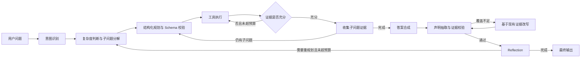

# 多模态汽车手册 Agentic RAG 系统

<div align="center">


**面向复杂汽车手册的多模态证据检索、受控 Agent 执行与可复现评测**

支持多轮对话 | 混合检索 | 质量自优化 | 多后端切换

[快速开始](#-快速开始) • [功能特性](#-功能特性) • [系统架构](#️-系统架构) 

</div>

---

## 📋 目录

- [项目简介](#-项目简介)
- [功能特性](#-功能特性)
- [系统架构](#️-系统架构)
- [技术栈](#️-技术栈)
- [快速开始](#-快速开始)
- [使用指南](#-使用指南)
- [项目结构](#-项目结构)
- [高级功能](#-高级功能)
- [常见问题](#-常见问题)

---

## 🎯 项目简介

这是一个面向汽车手册问答的 Agentic RAG 原型。系统处理文本、表格和图片，
通过父子块检索、文本与图片分层融合、证据评分和有限步重检回答复杂问题。
LLM 负责语义判断与规划，工具权限、参数范围、调用预算和终止条件由确定性
代码控制。

当前定位是**可复现的单机工程原型**，不是生产级多租户服务。Gradio 是主要
交互入口；持久化 Checkpoint、异步文档 ETL、FastAPI 服务和真实用户运行数据
属于后续阶段。

### 核心亮点

- **复杂文档解析**：文本、表格、图片分流，父子块检索后回填完整上下文
- **多模态融合**：文本向量、BM25、图片视觉向量与图片关联文本分层融合
- **受控规划**：模型生成结构化计划，本地 Schema 校验工具、参数和组合
- **证据门控**：证据不足时有限次改写重检，达到上限后降级联网搜索
- **答案 Grounding**：逐声明校验证据覆盖并绑定引用
- **执行保护**：请求级缓存、重复调用拦截、工具预算与安全终止
- **可观测性**：记录节点、模型、工具耗时、Token、结果和降级原因
- **可复现评测**：维护文本/表格与图片检索测试集、基线和延迟对照

### 适用场景

- ✅ 汽车/电子产品智能客服
- ✅ 企业内部知识库问答
- ✅ 技术文档助手
- ✅ FAQ 自动化响应

---

## ✨ 功能特性

### 1. 智能工作流 (LangGraph)



**核心节点：**
- **Query Decomposer**：识别比较、多对象和依赖型问题，生成 2～5 个子问题
- **Planner**：生成结构化工具计划；模型输出必须通过本地白名单与参数校验
- **Tool Executor**：执行 FAQ、RAG、博查搜索 MCP 或人工转接，并实施预算与去重
- **Retrieval Grader**：判断证据能否覆盖问题，不足时改写检索查询
- **Synthesizer**：合成单跳或多跳答案
- **Grounding**：抽取事实声明、验证证据支持并计算引用覆盖率
- **Reflection / Finalizer**：在有限预算内重规划，最终输出答案及来源

### 2. 分层多模态检索

| 层级 | 技术 | 作用 | 参数 |
|------|------|------|------|
| **文本候选** | FAISS + BM25 | 语义与关键词互补召回 | Top-15 |
| **图片候选** | 视觉向量 + 图片附近文本 | 视觉对象与语义上下文召回 | Top-15 |
| **融合与精排** | RRF + Reranker | 融合多路排名并筛选证据 | Top-6 |
| **上下文回填** | 父子块映射 | 子块精确检索、父块完整阅读 | 按候选回填 |


### 3. 质量自优化 (Reflection)

```python
质量评估维度：
- 相关性 (Relevance)：答案是否切题
- 完整性 (Completeness)：信息是否充分
- 准确性 (Accuracy)：事实是否正确
- 流畅性 (Fluency)：表达是否自然
```

**自动优化流程：**
1. 生成初版答案
2. Reflection 节点打分（0-10）
3. 若分数 < 7.0，提出改进建议
4. 重新规划执行（最多 3 轮）
5. 输出最佳答案

### 4. 多工具协同

| 工具 | 适用场景 | 数据源 |
|------|----------|--------|
| **RAGTool** | 产品参数查询 | PDF 文档库 |
| **FAQTool** | 标准问题 | 人工审核的 FAQ |
| **BochaSearchMCPTool** | 时效性或本地证据不足的问题 | 博查搜索 MCP |
| **Human Handoff** | 投诉或无法安全回答的问题 | 人工转接状态 |

**工具选择逻辑：**
```python
if intent == "faq":
    使用 FAQTool 优先
elif intent == "product_inquiry":
    使用 RAGTool
elif RAG证据不足且达到重检上限:
    使用博查搜索 MCP
```

博查搜索需要在`.env`中配置`BOCHA_API_KEY`，并确保本机已安装`uv`。默认
服务目录为`integrations/bocha-search-mcp-master`；启动命令、参数、工具名称
和超时时间可通过`BOCHA_MCP_*`环境变量覆盖。

---

## 🏗️ 系统架构

### 整体架构

```text
Gradio / CLI
    |
LangGraph Agent
    |-- 意图识别与复杂问题分解
    |-- 结构化规划 + 本地 Schema 校验
    |-- 工具执行预算、缓存、去重与 Trace
    |-- Retrieval Grader + 有限步查询改写
    |-- 单跳/多跳答案合成
    `-- 声明级 Grounding + Reflection
    |
Tools
    |-- FAQ
    |-- Multimodal RAG
    |     |-- FAISS / BM25 / Reranker
    |     |-- 文本与表格父子块
    |     `-- 视觉向量与图片关联文本
    |-- Bocha Search MCP
    `-- Human Handoff
```

### 数据流

```
用户问题 → 意图与复杂度判断 → 受校验的工具计划
       → 多路检索 → 证据评分 → 必要时改写重检
       → 收集单个或多个子问题证据 → 答案合成
       → 声明级证据校验与引用 → 有限步 Reflection → 最终输出
```

---

## 🛠️ 技术栈

### 核心框架

- **LangGraph** - 工作流编排
- **LangChain** - LLM 应用框架
- **Gradio** - Web UI 界面

### 检索技术

- **FAISS** - 向量检索
- **BM25** - 关键词检索
- **BGE Reranker** - 重排序模型
- **M3E** - 中文嵌入模型

### LLM 后端

- **Ollama** - 本地部署（推荐）
- **vLLM** - 高性能推理
- **OpenAI API** - 云端服务

### 文档处理

- **pdfplumber** - PDF 解析
- **PyPDF2** - PDF 处理
- **jieba** - 中文分词

### 其他

- **博查搜索 MCP / DDGS** - 联网搜索主路径与可选降级实现
- **LangSmith** - LLM 应用可观测性平台
- **python-dotenv** - 环境变量管理
- **torch** - 深度学习框架

---

## 🚀 快速开始

### 环境要求

#### 最低配置（仅使用 API）

- **Python**: 3.10+
- **内存**: 4GB+
- **磁盘**: 5GB+（存储项目和文档）
- **网络**: 稳定的网络连接

> 💡 **提示**：使用 OpenAI/阿里云/DeepSeek 等 API 服务，**无需 GPU 和大量磁盘空间**，仅在本地处理文档解析和向量检索。

#### 本地部署配置（运行本地模型）

- **Python**: 3.10+
- **GPU**: NVIDIA GPU（推荐，CPU 也可运行但较慢）
- **内存**: 16GB+
- **磁盘**: 50GB+（存储模型文件）

> ⚠️ **注意**：本地模型适合对数据隐私有要求或需要离线运行的场景。

### 1. 克隆项目

```bash
git clone <repository-url>
cd rag
```

### 2. 安装依赖

```bash
# 创建虚拟环境
python3.10 -m venv venv
source venv/bin/activate  # Windows: venv\Scripts\activate

# 安装依赖
pip install -r requirements.txt
```

### 3. 配置环境变量

```bash
# Linux/macOS
cp .env.example .env

# Windows PowerShell
Copy-Item .env.example .env

# 编辑 .env 文件
nano .env

# 只填写实际使用的模型/搜索密钥；不要提交 .env

```

### 4. 下载模型（可选）

> ⚠️ **如果使用 API 方案，可跳过此步骤**

#### 方案 A：使用 Ollama（推荐本地部署）

```bash
# 安装 Ollama
curl -fsSL https://ollama.com/install.sh | sh

# 拉取模型
ollama pull qwen2.5:7b          
ollama pull nomic-embed-text 
```

#### 方案 B：下载 HuggingFace 模型
> ⚠️ **如果需要使用其他模型，可能需要更改一部分本地模型调用代码**

```bash
# 下载模型到 pre_train_model/
mkdir -p pre_train_model
cd pre_train_model

# 使用 Git LFS 或 huggingface-cli 下载
# 嵌入模型
git clone https://huggingface.co/moka-ai/m3e-large

# 重排序模型
git clone https://huggingface.co/BAAI/bge-reranker-large 

# LLM 模型
# git clone https://huggingface.co/Qwen/Qwen-7B-Chat
```

### 5. 准备数据

```bash
# 将 PDF 文档放到 data/ 目录
cp your_document.pdf data/train_a.pdf
```

### 6. 启动系统

#### 方式 1：Gradio Web UI（推荐）

```bash
# 使用启动脚本
chmod +x start_gradio.sh
./start_gradio.sh

# 或直接运行
python app_gradio.py
```

访问：http://localhost:7860

#### 方式 2：命令行交互

```bash
python run_agent_interactive.py
```

#### 方式 3：批量测试

```bash
python run_agent.py
```

#### 方式 4：P0 离线验收

```bash
pip install -r requirements-dev.txt
python scripts/verify_p0.py
```

该命令不调用模型 API 或联网搜索，用于校验正式评测产物以及 Agent 核心控制
链路。完整测试分层见`docs/TESTING.md`，已实现与未实现能力边界见
`docs/P0_AUDIT.md`。

---


## 📖 使用指南

### Gradio Web UI

1. **启动服务**：
   ```bash
   python app_gradio.py
   ```

2. **打开浏览器**：访问 http://localhost:7860

3. **开始对话**：
   - 输入问题，点击"发送"
   - 查看右侧状态面板了解处理过程
   - 支持多轮对话

4. **功能按钮**：
   - 🗑️ 清空对话：清除历史记录
   - 🔄 重试：重新生成最后一条答案

### 命令行交互

```bash
python run_agent_interactive.py
```

**示例对话：**

```
用户: 吉利银河E8的续航是多少？
Agent: 根据产品手册，吉利银河E8在CLTC工况下纯电续航里程为620公里...
      [来源: FAQ] [置信度: 0.98] [质量: 8.5/10]

用户: 它的价格呢？
Agent: 根据上下文，您询问的是吉利银河E8的价格...
```

### 批量测试

```bash
# 测试 data/test_question.json 中的问题
python run_agent.py

# 查看结果
cat test_results_*.json
```

---

## 📁 项目结构

```
rag/
├── app_gradio.py                # Gradio Web UI 主程序
├── run_agent.py                 # Agent 批量测试
├── run_agent_interactive.py     # 命令行交互
├── config.py                    # 全局配置
├── requirements.txt             # 运行依赖
├── requirements-dev.txt         # 测试依赖
├── .env.example                 # 无密钥配置模板
├── start_gradio.sh              # 启动脚本
├── scripts/verify_p0.py         # 一键离线验收
├── docs/TESTING.md              # 测试分层与指标口径
├── docs/P0_AUDIT.md             # 能力证据与未实现边界
│
├── agent/                       # Agent 核心模块
│   ├── graph.py                 # LangGraph 工作流定义
│   ├── state.py                 # 状态数据结构
│   │
│   ├── nodes/                   # 工作流节点
│   │   ├── intent_classifier.py # 意图识别
│   │   ├── query_decomposer.py  # 复杂问题分解
│   │   ├── planner.py           # 结构化规划与 Schema 校验
│   │   ├── tool_executor.py     # 工具调用、预算、缓存与去重
│   │   ├── retrieval_grader.py  # 证据评分与查询改写
│   │   ├── synthesizer.py       # 答案合成
│   │   ├── grounding.py         # 声明级证据校验
│   │   ├── reflection.py        # 质量反思
│   │   └── finalizer.py         # 最终输出
│   │
│   ├── tools/                   # 工具集
│   │   ├── multimodal_rag_tool.py # 多模态 RAG 工具
│   │   ├── faq_tool.py          # FAQ 匹配工具
│   │   └── bocha_search_mcp_tool.py # 博查搜索 MCP
│   │
│   └── config/                  # Agent 配置
│       └── model_config.py      # 多模型配置
│
├── pdf_parse.py                 # PDF 文档解析
├── faiss_retriever.py           # FAISS 检索器
├── bm25_retriever.py            # BM25 检索器
├── rerank_model.py              # 重排序模型
├── embedding_model.py           # 嵌入模型接口
├── llm_model.py                 # LLM 统一接口
├── ollama_model.py              # Ollama 后端
├── vllm_model.py                # vLLM 后端
├── scoring_model.py             # 评分模型
│
├── data/                        # 数据目录
│   ├── evaluation/              # 版本化评测集与结果
│   ├── train_a.pdf              # 示例 PDF 文档
│   └── faq_database.json        # FAQ 数据库
│
├── vector_cache/                # 向量索引缓存
├── images/                      # 图片/可视化
├── .env                         # 本地环境变量（不提交）
└── README.md                    # 项目文档
```

> 当前为兼容已有入口，实验脚本与部分测试仍位于仓库根目录。后续服务化阶段再做
> 模块迁移，P0 不进行可能破坏导入路径的大规模重排。

---

## 评测结果

以下结果来自仓库内可追溯的 100 题正式评测文件，不与旧版 205 题实验混写。

### 文本与表格父子块检索

| 指标 | 结果 |
|---|---:|
| 子块 Recall@5 | 0.9208 |
| 父块 Recall@5 | 0.9600 |
| 子块 MRR | 0.9262 |
| 父块 MRR | 0.9378 |
| 平均延迟 | 851.4 ms |
| P95 延迟 | 1085.2 ms |

结果文件：`data/evaluation/results/text_table_retrieval_metrics.json`

### 图片视觉检索消融

| 策略 | Image Recall@5 | Image MRR | 平均延迟 |
|---|---:|---:|---:|
| 纯视觉向量 | 0.4100 | 0.3377 | 289.8 ms |
| 视觉向量 + 图片关联文本 RRF | 0.7567 | 0.6555 | 759.2 ms |

融合策略使 Image Recall@5 提升 `0.3467`、MRR 提升 `0.3178`，代价是平均
延迟增加约 `469 ms`。结果文件：
`data/evaluation/results/image_retrieval_comparison.json`。

评测集来自单份示例汽车手册，因此这些结果只能证明当前数据范围内的检索
效果，不能外推为多车型生产准确率。复现方式与指标口径见 `docs/TESTING.md`。

---

## 🎓 高级功能

### 1. 自定义 FAQ

编辑 `data/faq_database.json`：

```json
{
  "faqs": [
    {
      "id": "FAQ003",
      "question": "如何激活车辆？",
      "answer": "激活步骤：1. 打开吉利APP...",
      "keywords": ["激活", "车辆"],
      "category": "操作指南",
      "confidence": 1.0
    }
  ]
}
```

### 2. 工作流可视化

```python
from agent.graph import build_agent_graph, save_graph_visualization

graph = build_agent_graph()
save_graph_visualization(graph, "./images/workflow.png")
```

### 3. 性能优化

**向量缓存：**
- 首次运行自动生成 FAISS 索引
- 缓存到 `vector_cache/`
- 后续启动直接加载（10倍提速）

**并发配置：**
```bash
# Ollama 并发数
OLLAMA_MAX_WORKERS=3
```

### 4. Trace 与监控

系统在 `execution_trace` 中记录节点、模型和工具事件，并在 `metrics` 中汇总：

- 节点调用次数与分节点耗时
- LLM 调用次数、耗时和可获得的输入/输出 Token
- 工具参数、成功状态、错误、缓存命中与耗时
- 工具总次数、重复调用拦截和预算终止原因

这些数据当前随请求状态存在内存中。LangSmith是可选的外部导出能力，而不是
本地Trace存在的前提。跨进程持久化与历史运行回放尚未实现。

#### LangSmith 可观测性（推荐）

LangSmith 是 LangChain 官方的可观测性平台，可以追踪和调试 Agent 的完整执行过程。

**配置步骤：**

1. **注册 LangSmith**：访问 [smith.langchain.com](https://smith.langchain.com/) 注册账号

2. **获取 API Key**：在设置中创建 API Key

3. **配置环境变量**：
   ```bash
   # .env 文件
   ```

4. **启动系统**：正常运行文件，LangChain/LangGraph 调用会按配置上报；项目
   自己的 `execution_trace` 仍由 `agent/observability.py` 维护

**关闭 LangSmith：**
```bash
# .env 文件
LANGSMITH_TRACING=false
```

---

## ❓ 常见问题

### Q1: 启动后无法访问 Gradio 界面？

**A:** 检查端口占用：
```bash
lsof -i :7860
# 或修改端口
python app_gradio.py --server-port 8000
```

### Q2: FAISS 检索慢/准确率低？

**A:** 
- 检查 GPU 是否可用：`torch.cuda.is_available()`
- 调整嵌入模型：使用 `m3e-large` 或 API 模型
- 调整检索和重排序参数：修改 RAG 工具调用时的参数

### Q3: Ollama 连接失败？

**A:**
```bash
# 首先确认ollama服务端口，如果与配置不同需更改配置项为实际端口

# 检查服务状态
ollama list

# 重启服务
ollama serve

# 测试连接
curl http://localhost:11434/api/tags
```

### Q4: 答案质量不佳？

**A:**
1. 使用更强的模型（qwen-max/gpt-4）
2. 调整 Reflection 阈值（修改 `reflection.py` 中的阈值判断逻辑）
3. 优化提示词（`nodes/*.py` 中的 prompt）

### Q5: 如何清理缓存？

**A:**
```bash
python clean_cache.py
```

### Q6: LangSmith 追踪不工作或报错？

**A:**
1. 检查 API Key 是否正确(注意区分美国和欧洲地区，二者url不同)：
   ```bash
   echo $LANGSMITH_API_KEY
   ```

2. 确认 `LANGSMITH_TRACING=true`（注意不要加引号）

3. 检查网络连接（LangSmith 需要访问外网）

4. 查看服务器地址是否正确：

## 当前限制

- 当前交互入口以 Gradio/CLI 为主，尚无独立 FastAPI 服务层。
- LangGraph 状态未接入持久化 Checkpointer，服务重启后不能恢复运行。
- 文档解析和索引构建仍以同步脚本为主，尚无异步任务、版本发布与回滚。
- 正式评测主要基于单份汽车手册，不代表多车型、多年份场景效果。
- Trace 为请求级内存数据，可选上报 LangSmith，但尚无本地历史查询与回放。
- 尚未完成用户、知识库和车型维度的权限隔离。

这些边界会在后续服务化阶段逐步解决；README与简历不将当前版本描述为生产级
多租户系统。

## 🤝 贡献

欢迎贡献代码、报告问题或提出建议！

## 📄 许可证

本项目采用 [MIT License](LICENSE)


<div align="center">

**⭐ 如果这个项目对你有帮助，请给一个 Star！**


</div>
